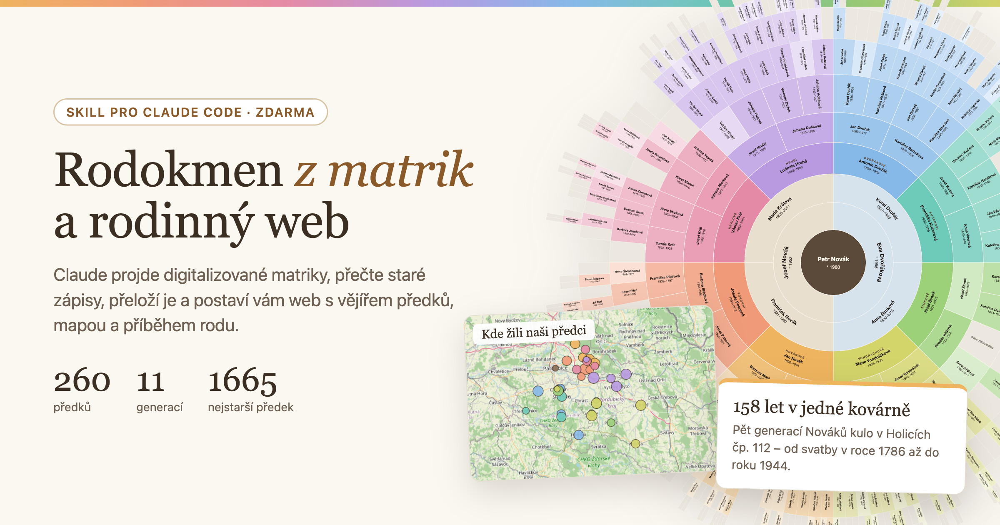

# Rodokmen pro OpenAI Codex / GPT

Adaptace českého genealogického [skillu Jindřicha Šaršona](https://github.com/sarsonj/rodokmen-skill) pro **OpenAI Codex**. Umožňuje od rodinných vzpomínek a dokumentů přes české i zahraniční digitalizované matriky vybudovat průkazný rodokmen a rodinný web s výřezy zápisů, překlady, mapou a vějířem předků.

**Verze:** `0.5.0-codex.1`, vychází ze zdrojové verze `0.5.0` (říjen 2026). Nejde o oficiální vydání původního autora ani o ověřený benchmark modelů GPT. Skripty a metodika jsou převzaty, agentní instrukce, instalace a výchozí konfigurace jsou přizpůsobeny Codexu.



## Rychlý start: Codex CLI nebo IDE

Na počítači se spuštěným Codexem:

```bash
git clone https://github.com/Koudy1996/rodokmen-skill-coppy-for-GPT.git
cd rodokmen-skill-coppy-for-GPT
codex
```

V konverzaci napiš:

```text
$rodokmen
Chci vytvořit rodokmen své rodiny od začátku. Proveď mě přípravou a ptej se na rodinné údaje po jednom.
```

Codex najde skill automaticky v `.agents/skills/rodokmen/SKILL.md`. Pokud chceš mít skill dostupný **ve všech svých projektech**, zkopíruj celou složku `.agents/skills/rodokmen` do `~/.agents/skills/rodokmen` (ve Windows do `%USERPROFILE%\.agents\skills\rodokmen`). Alternativně použij vestavěný `$skill-installer` a nasměruj jej na `https://github.com/Koudy1996/rodokmen-skill-coppy-for-GPT/tree/main/.agents/skills/rodokmen`.

Důležité: pro pohodlné procházení webových archivů je vhodnější **lokální Codex** s povoleným přístupem k internetu a s dostupným prohlížečem/Playwrightem. V izolovaném cloudovém prostředí mohou být přístup k archivům, interaktivní prohlížeč a lokální náhled omezeny.

## Výběr modelů podle práce

Připravené konfigurace v `.codex/config.toml` a `.codex/agents/` doporučují:

| Úloha | Model | Reasoning | Důvod |
|---|---|---|---|
| Hlavní vedení rodokmenu, kontrola důkazů a zápis do dat | **GPT-6.1 Sol** (`gpt-6.1-sol`) | high | Dlouhá agentní práce, plánování a náklady |
| První čtení historických snímků | **GPT-6.1 Terra** (`gpt-6.1-terra`) | medium | Zaměření na vizuální úlohy; vždy ověřit originál |
| Sporné čtení kurentu, zásadní identifikace předků | **GPT-6 Astra** (`gpt-6-astra`) | high | Nejnáročnější analýza a nezávislé protičtení |
| Rutinní rejstříky a jednoduché výpisy | **GPT-6 Luna** (`gpt-6-luna`) | low | Cena a rychlost jednoduchých úkolů |
| Dohledávání archivních souvislostí | **GPT-6.1 Sol** | medium | Kombinace rešerše a vyhodnocení |

Tohle je **doporučené rozdělení úloh, nikoli měřený výsledek na českých matrikách**. Dostupnost modelů závisí na účtu a verzi Codexu. Nedostupný model nahraď dostupným, nepovažuj potvrzení dvou modelů za samostatný genealogický důkaz a kritické údaje vždy ověř podle originálního zápisu.

`.codex/agents/` obsahuje volitelné role `archiv_researcher`, `matrika_reader`, `matrika_verifier`, `index_scout`. Při vytvoření samostatného rodokmenového projektu je inicializátor zkopíruje spolu s konfigurací; podagenti nejsou podmínkou funkčnosti.

## Co je třeba na počítači

Python 3.9+, Node.js 20+, ImageMagick a Git. Na Windows je vhodný Git Bash a oficiální Python. Codex zkontroluje závislosti v první fázi a před instalací si vyžádá schválení. Prohledávání archivů vyžaduje odpovídající připojení; CAPTCHA řeší uživatel.

Ruční vytvoření projektu po instalaci skillu:

```bash
python3 -I .agents/skills/rodokmen/tools/novy_projekt.py ~/Rodokmen
```

Na Windows použij `python -I -X utf8` a například cílovou složku `C:\Users\<uzivatel>\Rodokmen`. Po vytvoření otevři **nový projekt** v Codexu. Pokračování se řídí souborem `AGENTS.md`, `data/STAV.md` a `data/research_log.md`.

Ukázkový projekt s vymyšlenou rodinou:

```bash
python3 -I .agents/skills/rodokmen/tools/novy_projekt.py ~/Rodokmen-ukazka --ukazka
cd ~/Rodokmen-ukazka/web
npm install
npm run nahled
```

Lokální náhled bude na `http://localhost:4321`; [snímek původní ukázky webu](https://github.com/sarsonj/rodokmen-skill/blob/main/docs/ukazka-web.png).

## Průběh práce

V rodině začneš s tím, co víš, a přidáš rodinné dokumenty a případný GEDCOM. Codex navrhne důkazní postup, hledá svazky, stahuje odpovídající matriční snímky, dělá označené výřezy, přepisy a překlady, zapisuje každé hledání včetně neúspěšných a kontroluje souvislosti. Pak z ověřených údajů vytváří příběh a Astro web. Rozporné či nedoložené identifikace nesmí být automaticky potvrzeny.

Archivní skeny a přepisy jsou **pomůcka**, nikoli záruka správné genealogie. Neznámé hodnoty a pochybnosti se označují; pro právně důležitý rodokmen využij profesionálního genealoga. U živých osob zachovávej minimalizaci dat a před publikací jejich souhlas. Zálohy rodinných údajů vytvářej v soukromém úložišti, ne ve veřejném repozitáři.

## Struktura repozitáře

- `.agents/skills/rodokmen/SKILL.md` — hlavní instrukce pro Codex.
- `.agents/skills/rodokmen/reference/` — matriky, portály, práce s daty, publikace a soukromí.
- `.agents/skills/rodokmen/tools/` — původní pracovní skripty v Pythonu a shellu.
- `.agents/skills/rodokmen/template/` — data a webová šablona v Astro, včetně ukázkové rodiny a obrázků.
- `.agents/skills/rodokmen/template/.codex/` — modely a role automaticky přidávané do nového projektu.
- `.codex/` — nastavení Codexu při práci přímo v tomto repozitáři.
- `AGENTS.md` — projektové instrukce pro samotnou adaptaci.
- `scripts/verify_codex.py` — lokální strukturální kontrola a smoke-test inicializátoru.

## Ověření

```bash
python3 scripts/verify_codex.py
```

Kontrola ověří strukturu, čitelnost hlavních konfigurací, syntaxi Pythonu, vytvoření čistého i ukázkového projektu a absenci starých agentních příkazů. Pro úplné otestování webu spusť v ukázkovém projektu ještě `npm install && npm run build`. Spuštění v konkrétním klientovi Codexu, přístup do archivů a přesnost vizuálního čtení je nutné ověřit prakticky.

## Licence a autorství

Základ pod licencí **MIT**, původní autor **Jindřich Šaršon**; zachován soubor [LICENSE](LICENSE) a původní copyright. Tato adaptace mění instrukce, modelovou orchestraci a inicializaci projektů, nikoli autorství původních nástrojů.

**Výjimka:** `reference/playbook.md` v originálu nemá doložené oprávnění k šíření pod MIT. V této adaptaci je nahrazen krátkou poznámkou a [odkazem na původní text](https://github.com/sarsonj/rodokmen-skill/blob/main/skills/rodokmen/reference/playbook.md). Nepřebírej jej jako MIT materiál.

**Další technické omezení kopie:** původní demonstrační screenshot `docs/ukazka-web.png` není součástí této kopie; velký soubor je dostupný přes uvedený odkaz. Samotná šablona webu, exporty a obrázky ukázkových matričních zápisů jsou přeneseny.

O změny původního skillu se lze podělit s původním autorem prostřednictvím [issues](https://github.com/sarsonj/rodokmen-skill/issues); nikdy nepřikládej údaje o živých rodinných příslušnících.
